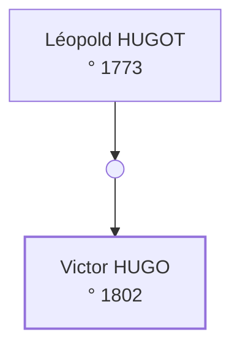

# Who were the parents of Victor Hugo, born about 1802 in Besançon?

## Sommaire

- [I Passe 1 — Acte de naissance](#s-pass-1)
  - [I.1 Le père présumé](#s-01j9zm00000000000000000002)
    - [I.1.1 Détail](#s-01j9zm00000000000000000003)
  - [I.2 Arbre](#s-tree-1)
- [II Passe 2 — Vérifications](#s-pass-2)
  - [II.1 Index](#s-01j9zm00000000000000000007)
  - [II.2 Arbre](#s-tree-2)
- [III Méthode](#s-method)
- [IV Sources](#s-sources)

## I Passe 1 — Acte de naissance

Victor : Victor HUGO, naissance, 26 février 1802, Besançon[^1]. Voir [§ I.1](#s-01j9zm00000000000000000002).

&lt;script>alert(1)&lt;/script>

### I.1 Le père présumé

Léopold HUGOT : Léopold HUGOT, naissance, vers 1773, Nanzig[^2].

#### I.1.1 Détail

Une sous-section.

### I.2 Arbre

## II Passe 2 — Vérifications

Les index concordent. Personne vivante est citée.

### II.1 Index

Une table.

| a | b |
|---|---|
| 1 | 2 |

### II.2 Arbre

## III Méthode

Rédigé avec l'aide d'agents d'IA : chaque fait cite sa source, et le moteur vérifie les citations et les règles de preuve ; relire les sources reste le travail du lecteur.

| Passe | Environnement | Agent | Modèle |
|---|---|---|---|
| 1 | claude-code | session |  |
| 2 | claude-code | session | claude-opus-5-5 |

## IV Sources

- Archives municipales de Besançon, État civil, Besançon, E-1802-N, acte 112, image 45, https://example.org/amb/e-1802-n/45 (consulted on 2026-09-30).
- Open Archives, Index of births, https://example.org/oa/1 (consulted on 2026-09-30).

[^1]: Acte. Archives municipales de Besançon, État civil, Besançon, E-1802-N, acte 112, image 45, https://example.org/amb/e-1802-n/45 (consulted on 2026-09-30).
[^2]: Index. Open Archives, Index of births, https://example.org/oa/1 (consulted on 2026-09-30).
